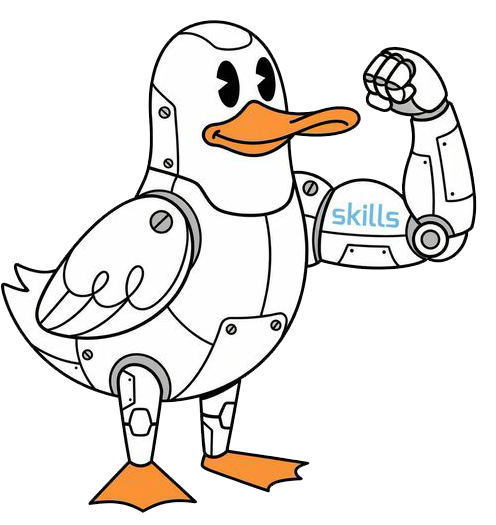

<h1> MotherDuck Skills</h1>

[](https://github.com/motherduckdb/agent-skills/releases/latest)
[](LICENSE)

23 skills for coding agents working with [MotherDuck](https://motherduck.com): connect applications, explore live schemas, write DuckDB SQL, build Dives and Flights, and ship analytics pipelines and apps.

Each skill pairs concise, opinionated instructions with deep references and runnable examples. The **GitHub Copilot CLI** and **Google Antigravity** plugins also bundle the hosted remote [MotherDuck MCP server](https://motherduck.com/docs/key-tasks/ai-and-motherduck/mcp-workflows/mcp-setup/) with OAuth sign-in; other installs ship skills only and leave connection setup to you.

## Install

Choose the install route for your agent. Commands starting with `/` run inside the agent; all others run in your terminal.

| Agent | Install |
| --- | --- |
| Claude Code | `/plugin marketplace add motherduckdb/agent-skills`, then `/plugin install motherduck-skills@motherduck-skills` |
| GitHub Copilot CLI | `/plugin marketplace add motherduckdb/agent-skills`, then `/plugin install motherduck@motherduck-skills` |
| Google Antigravity | `agy plugin install https://github.com/motherduckdb/agent-skills/tree/main/plugins/motherduck-skills-antigravity` |
| Codex | `codex plugin marketplace add motherduckdb/agent-skills`, then open `/plugins` and install **MotherDuck Skills** |
| Gemini CLI | `gemini extensions install https://github.com/motherduckdb/agent-skills` |
| Cursor / VS Code / other agents | Use the Skills CLI below |

The [Skills CLI](https://github.com/vercel-labs/skills) requires Git and Node.js 22.20+ ([package requirements](https://github.com/vercel-labs/skills/blob/main/package.json)) — no global install needed:

```bash
npx -y skills add motherduckdb/agent-skills
```

Pick skills and target agents interactively, or install the full catalog in one command (for example, Cursor):

```bash
npx -y skills add motherduckdb/agent-skills --agent cursor --skill '*' --yes --global
```

Swap `--agent cursor` for `--agent github-copilot` (VS Code / GitHub Copilot) or another supported agent, and omit `--global` for a project-scoped install.

See the [install matrix](docs/install-matrix.md) for updates, verification, and manual installs, and [HARNESSES.md](HARNESSES.md) for native plugin surfaces and discovery paths.

## Use the Skills

Describe your goal directly, or invoke a skill by name:

> Use motherduck-connect to choose the connection path for this app.

> Explore my MotherDuck workspace and build a sales dashboard as a Dive.

> Plan a migration to MotherDuck with validation and rollback steps.

For live warehouse work, sign in through the bundled MCP server (Copilot CLI / Antigravity), configure [MotherDuck MCP](https://motherduck.com/docs/key-tasks/ai-and-motherduck/mcp-workflows/mcp-setup/), or export credentials via your environment (`MOTHERDUCK_TOKEN`). Never paste tokens into prompts or committed files.

Start with the skill that matches your task — agents load references and lower-layer skills on demand. The catalog defaults to DuckDB SQL, live schema discovery, native MotherDuck storage, and backend credentials for customer-facing apps.

## Skills Overview

**Utility** skills handle individual operations; **workflow** skills cover specific MotherDuck capabilities; **use-case** skills combine them for end-to-end work.

| Skill | Layer | Use it for |
| --- | --- | --- |
| `motherduck-connect` | Utility | Connections, authentication, client selection, and read scaling |
| `motherduck-cli` | Utility | Terminal queries and file-based Dive/Flight workflows |
| `motherduck-explore` | Utility | Databases, schemas, shares, and sample data |
| `motherduck-query` | Utility | Writing, executing, and optimizing analytical SQL |
| `motherduck-duckdb-sql` | Utility | DuckDB syntax and MotherDuck feature support |
| `motherduck-rest-api` | Utility | Service accounts, tokens, Ducklings, and embed sessions |
| `motherduck-load-data` | Workflow | Bulk ingestion from files, storage, or external systems |
| `motherduck-model-data` | Workflow | Analytical schemas and transformation models |
| `motherduck-manage-guides` | Workflow | Business definitions and reusable warehouse context |
| `motherduck-share-data` | Workflow | Share audiences, grants, table filters, and refresh policy |
| `motherduck-create-dive` | Workflow | Creating, editing, designing, publishing, sharing, or embedding Dives |
| `motherduck-dive-components` | Workflow | Building Dive UIs from a component kit: stat cards, gauges, heatmaps, Sankey, treemaps, timelines, date pickers, brand themes, and custom components |
| `motherduck-create-flight` | Workflow | Running and scheduling Python jobs on MotherDuck |
| `motherduck-ducklake` | Workflow | DuckLake storage choices and operations |
| `motherduck-security-governance` | Workflow | Permissions, isolation, residency, and compliance |
| `motherduck-pricing-roi` | Workflow | Costs, plan fit, and ROI |
| `motherduck-build-cfa-app` | Use-case | Customer-facing analytics with tenant isolation |
| `motherduck-build-dashboard` | Use-case | A dashboard's analytical story, metrics, and section queries |
| `motherduck-build-malleable-dive` | Use-case | A generated Dive: daily briefing with insights to investigate, and question-to-page answers that viewers can rearrange |
| `motherduck-build-data-pipeline` | Use-case | Ingestion-to-serving pipelines |
| `motherduck-migrate-to-motherduck` | Use-case | Migration, reconciliation, cutover, and rollback |
| `motherduck-enable-self-serve-analytics` | Use-case | Governed analytics for internal teams |
| `motherduck-partner-delivery` | Use-case | Repeatable delivery across client engagements |

Browse the [source skills](skills/) or the [machine-readable catalog](skills/catalog.json).

## Troubleshooting

- **Skill not discovered:** check that it is installed for the agent you are using, reload the agent, and name the skill explicitly.
- **Live queries fail:** verify the MCP server or database connection and its credentials. Skills provide guidance, not account access.
- **PostgreSQL-only syntax:** use `motherduck-duckdb-sql`. PostgreSQL wire compatibility does not change the SQL dialect.

## Contributing

Edit source skills under `skills/`; the `plugins/` directories contain generated packages. See [CONTRIBUTING.md](CONTRIBUTING.md) for checks and package synchronization, [skill authoring](docs/skill-authoring.md) for conventions, and [ARCHITECTURE.md](ARCHITECTURE.md) for catalog rules.

Releases use the [release process](docs/release-process.md) and `scripts/bump_version.py`; do not edit version numbers by hand.

## Resources

- [MotherDuck documentation](https://motherduck.com/docs/)
- [DuckDB documentation](https://duckdb.org/docs/)
- [Agent Skills specification](https://agentskills.io)

## License

[MIT](LICENSE).
